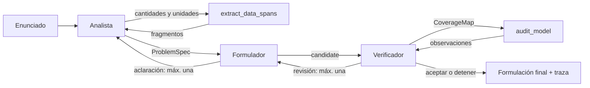

# Entrega 3 · Sistema de agentes para formulación LP/MILP

Esta carpeta contiene los agentes de generación y verificación, la auditoría determinista y el orquestador, probados localmente con `MockLLM`. **Todavía no hay un piloto GPU completo ni resultados oficiales de la Entrega 3.** Los módulos se integran mediante PR conforme a [AGENTS.md](../AGENTS.md).

La entrada es un enunciado en español. La salida evaluable conserva exactamente el formato textual de la columna `candidate` de la [Entrega 2](../Deliverable%202/): `Conjuntos`, `Parámetros`, `Variables de decisión`, `Función objetivo` y `Restricciones`. El sistema formula el problema; no obtiene el óptimo.

Los mensajes de control y cobertura se guardan separados de `candidate`. Las clases compartidas están en [schemas.py](schemas.py), su contrato en [docs/contratos.md](docs/contratos.md) y las decisiones en [docs/decisiones.md](docs/decisiones.md). Para validar localmente con Python 3.10 o superior: `python -m pip install -r "Deliverable 3/requirements.txt"` y `python -m unittest discover -s "Deliverable 3/tests"` desde la raíz del repositorio.

La interfaz del orquestador, sus presupuestos, variantes y trazas se describen en [docs/orquestador.md](docs/orquestador.md). El Verificador está documentado en [docs/verificador.md](docs/verificador.md) y los alcances del auditor y su calibración en [docs/audit_model.md](docs/audit_model.md). La configuración sigue en desarrollo; aún faltan la integración ejecutable de carga de modelo/run.py, el notebook y el piloto completo.

| Ruta | Propósito |
|---|---|
| `agents/`, `tools/` | Agentes y herramientas de cada responsable. |
| `prompts/` | Un archivo versionado por agente y revisión. |
| `config/` | Configuración de desarrollo y, después del piloto, configuración congelada. |
| `data/benchmark_30_generation_only.jsonl` | Los 30 enunciados, sin referencia ni requisitos oficiales. |
| `dev_cases/` | Ocho casos nuevos para desarrollar y congelar prompts. |
| `eval/` | Evaluación posterior con FOM-5 v2, separada de los agentes. |
| `results/`, `traces/` | Salidas por variante y mensajes completos por entrada. |
| `informe/` | Informe final de una página en LaTeX y PDF. |

El modelo base, el adapter y los resultados archivados se obtienen desde la Entrega 2 publicada. El conjunto con referencias oficiales se abre únicamente en la etapa de evaluación. Las instrucciones de reproducción de la corrida y del video se completarán cuando exista un sistema ejecutable.
