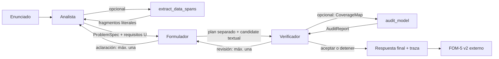

# Entrega 3 · Sistema de agentes para formulación LP/MILP

El sistema transforma un enunciado en español en un **borrador paramétrico** con conjuntos, parámetros, variables y dominios, objetivo y restricciones. No resuelve la instancia. Usa Qwen2.5-1.5B-Instruct (revisión `989aa7980e4cf806f80c7fef2b1adb7bc71aa306`) y el [adapter QLoRA público de Entrega 2](../Deliverable%202/adapter_qlora_qwen25_final.zip). El texto evaluable conserva el formato de la columna `candidate` de aquella entrega.

**Estado:** el piloto con ocho casos y el caso diagnóstico están archivados. La configuración de generación quedó fijada en [`v3-freeze`](https://github.com/Jose21531/GenAI-Optimization/tree/v3-freeze). La comparación nueva usará los primeros **15 casos** del benchmark para las cinco variantes; sus puntuaciones estarán disponibles después de ejecutar el juez externo. El benchmark completo de 30 casos de la Entrega 2 permanece archivado.

## Recorrido de los agentes



| Agente | Entrada | Decisión y herramienta | Salida |
|---|---|---|---|
| Analista | `id`, título y enunciado | Entregar o releer; puede consultar `extract_data_spans` | `ProblemSpec` JSON con requisitos propios `U1…Un` y evidencia literal. |
| Formulador | Enunciado, `ProblemSpec` y observaciones si las hay | Formular o pedir aclaración; no usa herramienta externa | Plan requisito→ecuación separado y `candidate` textual con cinco secciones. |
| Verificador | Enunciado, `ProblemSpec` y borrador | Aceptar, devolver o detener; puede consultar `audit_model` | `CoverageMap`, `ReviewDecision` y observaciones comprobables. |

El orquestador valida los mensajes, aplica los presupuestos y escribe una traza JSONL de cada corrida. `audit_model` detecta inconsistencias estructurales; la revisión semántica corresponde al Verificador. [Contratos](docs/contratos.md) · [Orquestación](docs/orquestador.md) · [Decisiones](docs/decisiones.md).

## Abrir y ejecutar

[**Abrir Deliverable_3.ipynb en Colab**](https://colab.research.google.com/github/Jose21531/GenAI-Optimization/blob/main/Deliverable%203/Deliverable_3.ipynb) · [Ver el cuaderno en GitHub](Deliverable_3.ipynb)

1. Abre la [carpeta compartida del experimento](https://drive.google.com/drive/folders/1paO1lnuqA1tNWOl9_T07WkH_JzGL66wD?usp=sharing). En la cuenta propietaria, la carpeta ya se llama `Resultados IA 3` y está en **Mi unidad**. En las otras cuentas, añade un **acceso directo a Mi unidad** con ese mismo nombre. Después, en Colab selecciona **Entorno de ejecución → Cambiar tipo de entorno → T4 GPU** y ejecuta la sección 1 para descargar el repositorio, instalar dependencias y cargar el modelo y el adapter. Si Colab pide reiniciar después de instalar PyTorch, reinicia y repite la sección.
2. Ejecuta la sección 2 para mostrar la [corrida archivada](results/diagnostic/initial/) del caso oftalmológico: `ProblemSpec`, plan, primer borrador, observaciones y respuesta final. `RUN_LIVE_DIAGNOSTIC=True` produce otra corrida real y guarda su respuesta y traza en la carpeta compartida `diagnostic/<fecha>/`; requiere un juicio nuevo para atribuirle puntaje. La sección 3 presenta la referencia y las respuestas de las tres entregas. `EXPORT_DIAGNOSTIC=True` en la celda de transferencia descarga la corrida nueva para incorporarla al repositorio.
3. La sección 4 muestra la puntuación de la respuesta diagnóstica archivada: **0,650/5** baseline, **3,850/5** QLoRA y **2,600/5** tres agentes. `RUN_DIAGNOSTIC_JUDGE=True` puntúa una respuesta nueva con Qwen3-14B y guarda el juicio asociado al hash exacto. El diagnóstico queda fuera de la muestra de 15 casos.
4. La sección 5 permite repetir el [piloto archivado](results/pilot/) de ocho casos con el adaptador del Verificador encendido y apagado. Con el adaptador apagado hubo un fallo de formato; encendido, seis. Esa comparación determinó la configuración congelada.

5. Para generar la muestra, en la sección 6 fija `CONFIGURATION` en **1, 2, 3, 4 o 5**, `FIRST_CASE=1`, `LAST_CASE=15` y `RUN_VARIANT=True`. Ejecuta una variante por cuenta con T4. La celda monta Drive, comprueba que la carpeta compartida existe y escribe allí `results/<variante>/outputs.jsonl`, un manifiesto de subconjunto y las trazas al terminar cada caso. La celda de estado permite ver el avance de las cinco variantes. Si una sesión cae, otra cuenta con el acceso directo puede ejecutar la misma configuración y omitir los IDs completos. **No ejecutes dos sesiones de la misma variante a la vez.**
6. Cuando las cinco variantes indiquen **15/15**, activa `RUN_EVALUATE_15=True` con una T4 disponible. El juez externo lee sus salidas desde la carpeta compartida y guarda y reanuda por ID los **75 juicios** y cinco CSV en `evaluation-15/`. La celda `EXPORT_VARIANT`/`IMPORT_ARCHIVES` queda como respaldo si una cuenta no puede montar el acceso directo.
7. Activa `RUN_COMPARE_15=True` para calcular, sin GPU, medias, diferencias pareadas, intervalos bootstrap, conteos de mejora/empate/empeoramiento y costo. Esta etapa lee los puntajes archivados de baseline y QLoRA directamente de `Deliverable 2/output/`, filtra sus primeros 15 IDs y guarda `summary.json`. Los archivos se incorporan al repositorio al cerrar la medición.

Para el video de hasta tres minutos, abre este README y el enlace de Colab. Prepara la T4 y el modelo antes de grabar; fija `RUN_LIVE_DIAGNOSTIC=True` en la sección 2 y **ejecuta ese caso durante la grabación**. Muestra los mensajes del Analista, Formulador y Verificador y la respuesta final. La sección 3 permite contrastarla con las respuestas archivadas; no atribuyas a la nueva respuesta el puntaje de la corrida anterior. Si deseas mostrar un puntaje de esa respuesta exacta, activa su juez en la sección 4. Exporta el ZIP diagnóstico para publicar la traza del video. Puedes editar pausas de carga para mantener el video en tres minutos. La generación de los 15 casos se ejecuta por separado.

## Ablaciones y archivos

Las cinco variantes usan el mismo modelo, enunciados y criterio de evaluación. `full` emplea todo el sistema; `no_evidence` retira las citas del Analista; `no_plan` retira el plan del Formulador; `no_audit` omite la herramienta del Verificador; `no_review` impide devolver el borrador para corregirlo. Baseline y QLoRA son las respuestas **archivadas** de Entrega 2, no variantes nuevas de generación.

`data/benchmark_30_generation_only.jsonl` contiene únicamente `id`, `title` y `problem`. El gold de los 30 casos se abre solo en `eval/`. Para el caso diagnóstico, `data/diagnostic_oftalmo_input.jsonl` es la entrada de los agentes y `data/diagnostic_oftalmo_gold.json` es la referencia del evaluador, extraída del evaluador original de Entrega 2. Ningún prompt ni herramienta de generación recibe el gold.

`run.py` genera un `RunResult` por ID y variante en `outputs.jsonl`, más una traza por ID bajo `traces/`. Guarda cada resultado al terminar y omite IDs completos al reanudar con la misma identidad de código y configuración. Para los ocho casos de desarrollo:

```bash
python "Deliverable 3/run.py" --mode development --variants full
```

La configuración está en `config/frozen.yaml`, identificada por `v3-freeze`. La celda de la sección 6 usa ese código y genera los primeros 15 casos de `data/benchmark_30_generation_only.jsonl` por variante. `eval/five_15.py score` exige exactamente los mismos 15 IDs en las cinco variantes, comprueba la identidad y los hashes de las salidas, y ejecuta FOM-5 v2 con el juez externo Qwen3-14B. Su calibración y su regla de agregación son las originales. `eval/five_15.py summarize` relee y valida los juicios ya guardados y realiza la comparación en una etapa separada. El [protocolo de evaluación](eval/README.md) explica el juez y la reanudación. Una salida fallida de generación permanece en el conjunto; un fallo del juez detiene la evaluación sin inventar puntajes.

## Comprobación local

Con Python 3.10 o superior, desde la raíz del repositorio:

```bash
python -m pip install -r "Deliverable 3/eval/requirements.txt"
python -m unittest discover -s "Deliverable 3/tests"
python -m unittest discover -s "Deliverable 3/eval/tests"
python "Deliverable 3/eval/run_eval.py" verify-archives
```

Las pruebas CPU comprueban contratos, herramientas, rutas del orquestador, checkpoints y la reproducción de los 60 puntajes archivados; **no sustituyen** el piloto GPU ni el juicio real de resultados nuevos.
