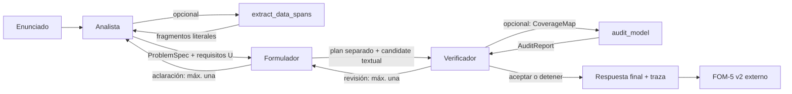

# Entrega 3 · Sistema de agentes para formulación LP/MILP

El sistema transforma un enunciado en español en un **borrador paramétrico** con conjuntos, parámetros, variables y dominios, objetivo y restricciones. No resuelve la instancia. Usa Qwen2.5-1.5B-Instruct (revisión `989aa7980e4cf806f80c7fef2b1adb7bc71aa306`) y el [adapter QLoRA público de Entrega 2](../Deliverable%202/adapter_qlora_qwen25_final.zip). El texto evaluable conserva el formato de la columna `candidate` de aquella entrega.

**Estado:** el piloto con ocho casos, el caso diagnóstico, las [75 respuestas de las cinco variantes](results/experiment_15/) y sus [75 juicios FOM-5 v2](results/evaluation-15/) están archivados. La configuración de generación quedó fijada en [`v3-freeze`](https://github.com/Jose21531/GenAI-Optimization/tree/v3-freeze). La comparación usa los primeros **15 casos** del benchmark; el conjunto completo de 30 de la Entrega 2 permanece como antecedente. [Informe de una página](informe/informe.pdf).

| Sistema · mismos 15 casos | Media FOM-5 v2 / 5 | Diferencia frente a QLoRA |
|---|---:|---:|
| Prompt directo · Entrega 1 (archivado) | 0,909 | −0,221 |
| QLoRA · Entrega 2 (archivado) | 1,130 | referencia |
| Tres agentes · `full` | 0,739 | −0,391 |
| `no_evidence` | 0,563 | −0,567 |
| `no_plan` | 1,099 | −0,031 |
| `no_audit` | 1,120 | −0,010 |
| `no_review` | 1,120 | −0,010 |

En `full`, 3 casos mejoran, 6 empatan y 6 empeoran frente a Entrega 2; el intervalo bootstrap del 95 % para la diferencia media es [−1,399; 0,549]. **No se demuestra una mejora.** Los 75 resultados de generación terminaron con un estado de fallo (43 de formato, 32 de presupuesto); el juez puntuó el texto final guardado, incluidos cuatro textos vacíos. `no_audit` y `no_review` obtuvieron la misma puntuación en cada ID y compartieron 14 de 15 textos finales. El [resumen completo](results/evaluation-15/summary.json) contiene intervalos, conteos y costos.

## Recorrido de los agentes



| Agente | Entrada | Decisión y herramienta | Salida |
|---|---|---|---|
| Analista | `id`, título y enunciado | Entregar o releer; puede consultar `extract_data_spans` | `ProblemSpec` JSON con requisitos propios `U1…Un` y evidencia literal. |
| Formulador | Enunciado, `ProblemSpec` y observaciones si las hay | Formular o pedir aclaración; no usa herramienta externa | Plan requisito→ecuación separado y `candidate` textual con cinco secciones. |
| Verificador | Enunciado, `ProblemSpec` y borrador | Aceptar, devolver o detener; puede consultar `audit_model` | `CoverageMap`, `ReviewDecision` y observaciones comprobables. |

El orquestador valida los mensajes, aplica los presupuestos y escribe una traza JSONL de cada corrida. `audit_model` detecta inconsistencias estructurales; la revisión semántica corresponde al Verificador. [Contratos](docs/contratos.md) · [Orquestación](docs/orquestador.md) · [Decisiones](docs/decisiones.md).

## Abrir y ejecutar

[**Abrir Deliverable_3.ipynb en Colab**](https://colab.research.google.com/github/Jose21531/GenAI-Optimization/blob/main/Deliverable%203/Deliverable_3.ipynb) · [Ver el cuaderno en GitHub](Deliverable_3.ipynb)

1. En Colab selecciona **Entorno de ejecución → Cambiar tipo de entorno → T4 GPU** y ejecuta la sección 1 para cargar el repositorio, instalar dependencias y preparar el modelo. Si Colab solicita reiniciar después de instalar PyTorch, reinicia y repite la sección. La demostración del caso no usa Drive.
2. Ejecuta la sección 2 para generar una **corrida nueva** del caso oftalmológico. La celda guarda respuesta y traza en `/content/d3_diagnostic/<fecha>/`; la siguiente muestra `ProblemSpec`, plan, borrador, observaciones y respuesta final. La sección 3 presenta la referencia y las respuestas baseline y QLoRA archivadas junto a la nueva formulación. `EXPORT_DIAGNOSTIC=True` en la celda de transferencia descarga la traza local en un ZIP.
3. La sección 4 permite puntuar la respuesta nueva con `RUN_DIAGNOSTIC_JUDGE=True`: Qwen3-14B guarda el juicio asociado al hash exacto de ese texto. Los puntajes **0,650/5** (baseline), **3,850/5** (QLoRA) y **2,600/5** (tres agentes) pertenecen a las [respuestas diagnósticas archivadas](results/diagnostic/initial/). El caso queda fuera de la muestra oficial de 15.
4. La sección 5 muestra el [piloto archivado](results/pilot/) de ocho casos con el adaptador del Verificador encendido y apagado. Con el adaptador apagado hubo un fallo de formato; encendido, seis. Esa comparación determinó la configuración congelada.

5. Para reproducir la muestra, añade primero la [carpeta compartida del experimento](https://drive.google.com/drive/folders/1paO1lnuqA1tNWOl9_T07WkH_JzGL66wD?usp=sharing) a **Mi unidad** con el nombre `Resultados IA 3` (original o acceso directo). En la sección 6 fija `CONFIGURATION` en **1, 2, 3, 4 o 5**, `FIRST_CASE=1`, `LAST_CASE=15` y `RUN_VARIANT=True`. Ejecuta una variante por cuenta con T4. La celda monta Drive y escribe `results/<variante>/outputs.jsonl`, el manifiesto y las trazas tras cada caso. Si una sesión cae, otra cuenta puede omitir los IDs completos. **No ejecutes dos sesiones de la misma variante a la vez.**
6. Activa `RUN_EVALUATE_15=True` con una T4 disponible. El juez externo lee las [salidas completas y verificadas](results/experiment_15/) desde el repositorio y guarda y reanuda por ID los **75 juicios** y cinco CSV en la carpeta compartida `evaluation-15/`. La copia versionada evita la ambigüedad de carpetas homónimas creadas por varias cuentas en Drive.
7. La última celda muestra la tabla de puntajes ya medida desde el [resumen versionado](results/evaluation-15/summary.json). El archivo conserva diferencias pareadas, intervalos bootstrap, conteos y costo. Para recalcularlo desde los juicios, usa el comando `summarize` descrito en el [protocolo de evaluación](eval/README.md); esta operación no usa GPU.

Para el video de hasta tres minutos, abre este README y el enlace de Colab. Prepara la T4 y el modelo antes de grabar; ejecuta la sección 2 durante la grabación. Muestra los mensajes del Analista, Formulador y Verificador y la respuesta final. En la sección 3 contrástala con las respuestas archivadas. La puntuación de una respuesta nueva se obtiene con el juez opcional de la sección 4; el puntaje archivado de tres agentes corresponde a otra corrida. La sección 6 reproduce por separado las variantes oficiales y usa Drive.

## Ablaciones y archivos

Las cinco variantes usan el mismo modelo, enunciados y criterio de evaluación. `full` emplea todo el sistema; `no_evidence` retira las citas del Analista; `no_plan` retira el plan del Formulador; `no_audit` omite la herramienta del Verificador; `no_review` impide devolver el borrador para corregirlo. Baseline y QLoRA son las respuestas **archivadas** de Entrega 2, no variantes nuevas de generación.

`data/benchmark_30_generation_only.jsonl` contiene únicamente `id`, `title` y `problem`. El gold de los 30 casos se abre solo en `eval/`. Para el caso diagnóstico, `data/diagnostic_oftalmo_input.jsonl` es la entrada de los agentes y `data/diagnostic_oftalmo_gold.json` es la referencia del evaluador, extraída del evaluador original de Entrega 2. Ningún prompt ni herramienta de generación recibe el gold.

`run.py` genera un `RunResult` por ID y variante en `outputs.jsonl`, más una traza por ID bajo `traces/`. Guarda cada resultado al terminar y omite IDs completos al reanudar con la misma identidad de código y configuración. Se conserva una [traza oficial representativa de fallo](traces/experiment_15/no_evidence/official_segment-no_evidence-opt_01-1429aaef.jsonl). Para los ocho casos de desarrollo:

```bash
python "Deliverable 3/run.py" --mode development --variants full
```

La configuración está en `config/frozen.yaml`, identificada por `v3-freeze`. La celda de la sección 6 usa ese código y genera los primeros 15 casos de `data/benchmark_30_generation_only.jsonl` por variante. `eval/five_15.py score` exige exactamente los mismos 15 IDs en las cinco variantes, comprueba la identidad y los hashes de las salidas, y ejecuta FOM-5 v2 con el juez externo Qwen3-14B. Su calibración y su regla de agregación son las originales. `eval/five_15.py summarize` relee y valida los juicios ya guardados y realiza la comparación en una etapa separada. El [protocolo de evaluación](eval/README.md) explica el juez y la reanudación. Una salida fallida de generación permanece en el conjunto; un fallo del juez detiene la evaluación sin inventar puntajes.

## Comprobación local

Con Python 3.10 o superior, desde la raíz del repositorio:

```bash
python -m pip install -r "Deliverable 3/eval/requirements.txt"
python -m unittest discover -s "Deliverable 3/tests"
python -m unittest discover -s "Deliverable 3/eval/tests"
python "Deliverable 3/eval/run_eval.py" verify-archives
```

Las pruebas CPU comprueban contratos, herramientas, rutas del orquestador, checkpoints y la reproducción de los 60 puntajes archivados; **no sustituyen** el piloto GPU ni el juicio real de resultados nuevos.
