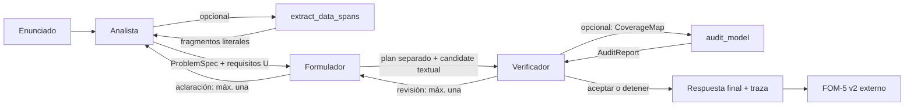

# Entrega 3 · Sistema de agentes para formulación LP/MILP

El sistema transforma un enunciado en español en un **borrador paramétrico** con conjuntos, parámetros, variables y dominios, objetivo y restricciones. No resuelve la instancia. Usa Qwen2.5-1.5B-Instruct (revisión `989aa7980e4cf806f80c7fef2b1adb7bc71aa306`) y el [adapter QLoRA público de Entrega 2](../Deliverable%202/adapter_qlora_qwen25_final.zip). El texto evaluable conserva el formato de la columna `candidate` de aquella entrega.

**Estado:** la integración y las pruebas CPU están listas. Los puntajes nuevos requieren el piloto y la corrida real en Colab T4; no se atribuyen resultados oficiales de Entrega 3 antes de completarlos.

## Recorrido de los agentes



| Agente | Entrada | Decisión y herramienta | Salida |
|---|---|---|---|
| Analista | `id`, título y enunciado | Entregar o releer; puede consultar `extract_data_spans` | `ProblemSpec` JSON con requisitos propios `U1…Un` y evidencia literal. |
| Formulador | Enunciado, `ProblemSpec` y observaciones si las hay | Formular o pedir aclaración; no usa herramienta externa | Plan requisito→ecuación separado y `candidate` textual con cinco secciones. |
| Verificador | Enunciado, `ProblemSpec` y borrador | Aceptar, devolver o detener; puede consultar `audit_model` | `CoverageMap`, `ReviewDecision` y observaciones comprobables. |

El orquestador valida los mensajes, aplica los presupuestos y escribe una traza JSONL de cada corrida. `audit_model` detecta inconsistencias estructurales; la revisión semántica corresponde al Verificador. [Contratos](docs/contratos.md) · [Orquestación](docs/orquestador.md) · [Decisiones](docs/decisiones.md).

## Abrir y ejecutar

[**Abrir Deliverable_3.ipynb en Colab**](https://colab.research.google.com/github/Jose21531/GenAI-Optimization/blob/main/Deliverable%203/Deliverable_3.ipynb) · [Ver el cuaderno en GitHub](Deliverable_3.ipynb)

1. Selecciona **Entorno de ejecución → Cambiar tipo de entorno → T4 GPU**. Ejecuta la sección 1 para descargar el repositorio, instalar dependencias y cargar el modelo y el adapter. Si Colab pide reiniciar después de instalar PyTorch, reinicia y repite la sección.
2. Ejecuta la sección 2: procesa **solo** el caso de centros oftalmológicos y muestra el análisis, el plan, los borradores, la revisión y la respuesta final. La sección 3 compara esa respuesta con las respuestas exactas archivadas del baseline y de Entrega 2, además de la formulación de referencia.
3. Para puntuar la respuesta nueva, activa `RUN_DIAGNOSTIC_JUDGE` en la sección 4. La celda libera el modelo generador, calibra Qwen3-14B y guarda el juicio FOM-5 v2 del caso. Los puntajes archivados de este mismo caso son 0,650/5 (baseline) y 3,850/5 (QLoRA). El caso es **diagnóstico**: no se incluye en la media oficial de 30 problemas.
4. La sección 5 ejecuta el piloto de ocho casos al activar `RUN_PILOT`; compara el Verificador con el adapter encendido y apagado, cada uno con generación y juicio posterior. La sección 6 reproduce los 30 casos al activar `RUN_GENERATE_30` y, una vez terminada la generación, `RUN_EVALUATE_30`. Las opciones comienzan en `False`. Para conservar checkpoints entre sesiones de Colab, asigna `ARTIFACT_ROOT` a una ruta persistente propia; la reproducción desde cero también funciona en `/content`.

La grabación de hasta tres minutos puede partir desde GitHub y seguir el enlace al cuaderno. Prepara el modelo antes de grabar; muestra la ejecución del caso diagnóstico, sus mensajes intermedios y la comparación final. La sección de 30 casos queda para reproducción, fuera del recorrido breve.

## Ablaciones y archivos

Las cinco variantes usan el mismo modelo, enunciados y criterio de evaluación. `full` emplea todo el sistema; `no_evidence` retira las citas del Analista; `no_plan` retira el plan del Formulador; `no_audit` omite la herramienta del Verificador; `no_review` impide devolver el borrador para corregirlo. Baseline y QLoRA son las respuestas **archivadas** de Entrega 2, no variantes nuevas de generación.

`data/benchmark_30_generation_only.jsonl` contiene únicamente `id`, `title` y `problem`. El gold de los 30 casos se abre solo en `eval/`. Para el caso diagnóstico, `data/diagnostic_oftalmo_input.jsonl` es la entrada de los agentes y `data/diagnostic_oftalmo_gold.json` es la referencia del evaluador, extraída del evaluador original de Entrega 2. Ningún prompt ni herramienta de generación recibe el gold.

`run.py` genera un `RunResult` por ID y variante en `results/<modo>/<variante>/outputs.jsonl`, más una traza por ID bajo `traces/`. Guarda cada resultado al terminar y omite IDs completos al reanudar con la misma identidad de código y configuración. Para los ocho casos de desarrollo:

```bash
python "Deliverable 3/run.py" --mode development --variants full
```

Después de congelar `config/frozen.yaml` y crear `v3-freeze`, el comando oficial es:

```bash
python "Deliverable 3/run.py" --mode official --variants full no_evidence no_plan no_audit no_review
```

`eval/run_eval.py` verifica los manifiestos, ejecuta FOM-5 v2 con un juez externo Qwen3-14B y conserva juicios y métricas por caso. El [protocolo de evaluación](eval/README.md) explica la calibración y la reanudación. Las salidas fallidas de generación permanecen en los 30 IDs; un fallo del juez detiene la evaluación sin inventar puntajes.

## Comprobación local

Con Python 3.10 o superior, desde la raíz del repositorio:

```bash
python -m pip install -r "Deliverable 3/eval/requirements.txt"
python -m unittest discover -s "Deliverable 3/tests"
python -m unittest discover -s "Deliverable 3/eval/tests"
python "Deliverable 3/eval/run_eval.py" verify-archives
```

Las pruebas CPU comprueban contratos, herramientas, rutas del orquestador, checkpoints y la reproducción de los 60 puntajes archivados; **no sustituyen** el piloto GPU ni el juicio real de resultados nuevos.
